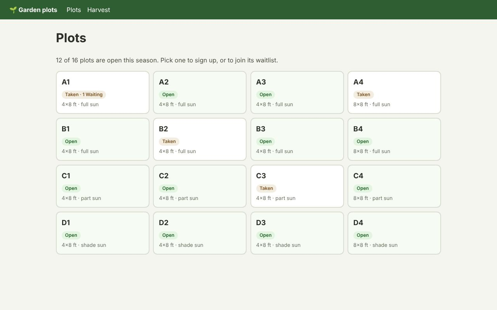

# Garden plots: Flask, Jinja and SQLite



The same garden from Rust is in [`../axum-garden`](../axum-garden), and its test checks the HTML is identical.

This one needs a server, so it isn't in the [live demos](https://journey-to-code-org.github.io/zubra/); the commands below run it.

A community garden's plot sign-up, in Python: Flask routes, Jinja templates and SQLite (the
standard library's `sqlite3`). Its Zubra components are rendered to HTML by the **Rust compiler**,
so there is **no Node.js on the server**, and no bundler. The browser hydrates that markup in
place.

```sh
cargo build                                  # from the repository root: the zubra CLI
cd examples/backends/flask-garden
pip install -r requirements.txt
python app.py                                # http://localhost:5000
```

Set `FLASK_DEBUG=1` to recompile components on every request while you edit them, and
`GARDEN_DB=garden.db` to keep the data between runs (it's in memory by default).

## What's where

| | |
|---|---|
| the `zubra` package | [`clients/python`](../../../clients/python): `Zubra(components).page().render(name, **props)`, CSS and browser modules, Jinja helpers. Standard library only. |
| `garden/__init__.py` | The Flask app: routes, validation, and `zubra(…)` for templates. |
| `garden/store.py` | Plots, reservations, the waitlist and harvests, in SQLite. |
| `templates/` | Jinja pages. `{{ zubra('crop-picker', name='crops', options=crops) }}` renders a component. |
| `components/` | Five `.zb` components. |
| `tests/test_app.py` | Every page in Chromium, with JavaScript off and on (Playwright for Python). |

## How it works

The `zubra` package keeps one `zubra serve` process: a JSON request per line on its standard input, and a
JSON response per line back. Each request carries every component's source, so imports between
components resolve without the CLI reading the disk:

```json
{ "emit": "html", "path": "/components/plot-map.zb", "files": { "/components/plot-map.zb": "…" },
  "props": { "plots": […], "selected": "B1" }, "slotSource": "html", "partial": true }
```

Each page records the components it rendered. The layout then puts their CSS in the `<head>`
and imports their modules (`/components/<name>.js`, which the CLI compiles too) at the end of
the body. `@zubra/runtime` is served as the plain ES modules it is, through an import map.

## Without JavaScript

Every page works without JavaScript. The components put native form controls in light DOM:
- crop checkboxes;
- a `<input type="number">`;
- links for the plot map.

Signing up, joining a waitlist and logging a harvest are ordinary form posts. A form with errors
comes back with what was typed and chosen.

With JavaScript, the same markup becomes interactive:
- the crop picker counts as you pick, and disables what you can't add;
- the number fields get − and + buttons;
- the arrow keys move around the plot map.

## What it found

The server renders with the compiler alone: the template's expressions, and the script's
deterministic JavaScript (string, array and number methods, `Math` without `random`, arrow
functions), but never `Intl` or `Date`. That's the whole story on a non-JS server, so its gaps
show up here first. `plan/roadmap-server.md` has the details and the plan.

- **Form state has to render on the server.** What the server can't evaluate is left for the
  browser: an attribute omitted, text left empty. For a checkbox, that means *unchecked* in the
  server's HTML, so a form re-rendered after an error would lose its choices without JavaScript.
  The components compute their own state (`value.includes(…)`, `Math.max(…)`), and the server
  evaluates it.
- **`zubra check --server` reports what's left for the browser.** A gap like that is a bug you
  only find with JavaScript off, so it reports one as an error for form state (`checked`,
  `selected`, `value`, `disabled`).
- **A prop's default sets its type.** `max="3"` is a string, so `value.length >= max` is an
  error ("comparison requires two numbers or two strings"). It has to be `max={3}`. The error is
  right, but it's met on the server first, as a 500.
- **One process for every render.** Starting the CLI for each render costs about 5 ms with a
  debug build, or about 15 ms for a page with three components. `zubra serve` keeps one process,
  which cuts pages by about 40%.
- **`name` is a common prop and a common Python argument.** `zubra('crop-picker', name='crops')`
  works because `render`'s own argument is positional-only.
