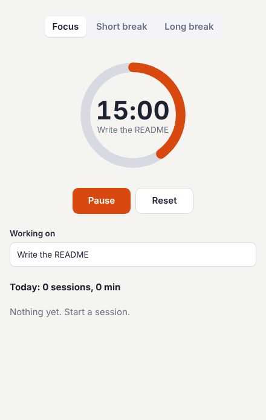

# Focus: an Electron app



This one is a desktop app, so it isn't in the [live demos](https://journey-to-code-org.github.io/zubra/); the commands below run it.

A desktop focus timer (25-minute sessions and breaks) in Electron. The window shows:
- the mode (the registry's `segmented-control`);
- the timer (`focus-timer`, built on the registry's `progress-ring`);
- what you're working on;
- today's log (`session-log`).

Finished sessions are saved as JSON in your user data folder, and each one ends with a desktop
notification.

```sh
cargo build                 # from the repository root (the compiler, until @zubra/compiler is on npm)
cd examples/desktop/focus-timer
npm install
npm start
```

The renderer is locked down the way Electron recommends:
- `contextIsolation`, `sandbox` and no Node.js;
- a preload (`preload.cjs`) that exposes three calls and nothing else;
- a Content Security Policy that allows only the app's own files:
  `script-src 'self'; style-src 'self'`, with no inline scripts, `eval` or inline styles.

The renderer is built with esbuild and Zubra's esbuild plugin (`build.mjs`). The tests drive the
app through Playwright's Electron support, with a fake clock so 25 minutes take no time.

## What it found

- **Zubra works under a strict CSP as it is.** Components' CSS is adopted as constructed
  stylesheets, which `style-src 'self'` doesn't block (it blocks `<style>` and `style=""`), and
  nothing is `eval`ed. A test checks the styles apply and the console has no violations.
- **`window.focus` is taken.** The first name for the preload's API was `focus`, which is
  `window.focus()`, so `contextBridge` refused it. (Not a Zubra problem, but worth knowing in an
  app called Focus.)
- **A prop that seeds state needed an effect to follow changes** (fixed in 2.9). `let left =
  seconds` reads `seconds` once, so when the app switched modes, the timer noticed the new length
  with a saved copy and an `effect()`. Now it's `let left = from(seconds)` and
  `let running = from(seconds, false)`: both start over on a new length. `zubra convert` writes the
  same for React's `useState(prop)` plus a reset effect.
- **The renderer's `document.title` isn't the window's title.** Tests read the window's title
  from the main process.
