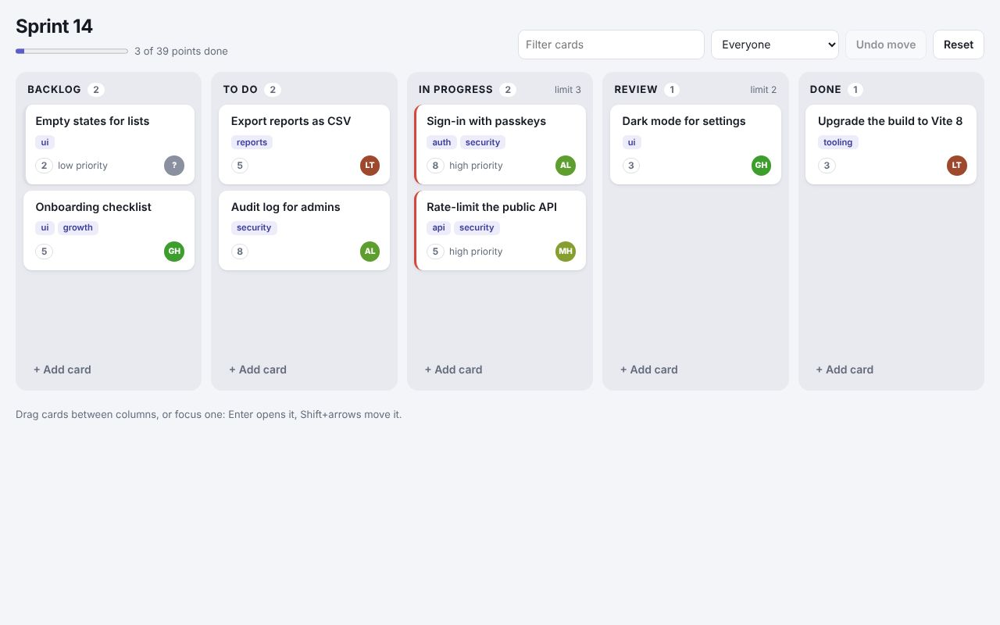
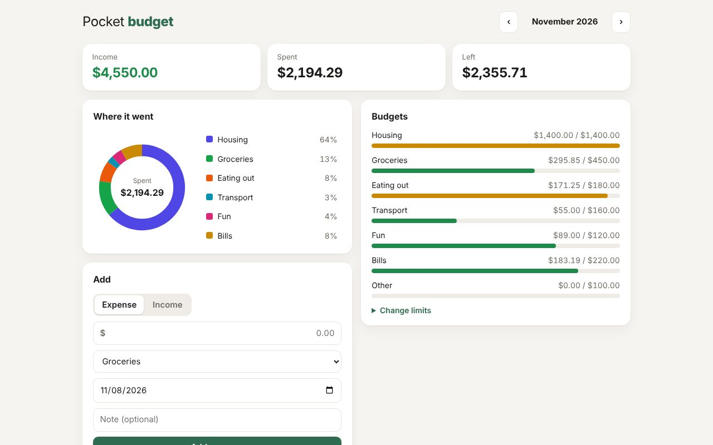
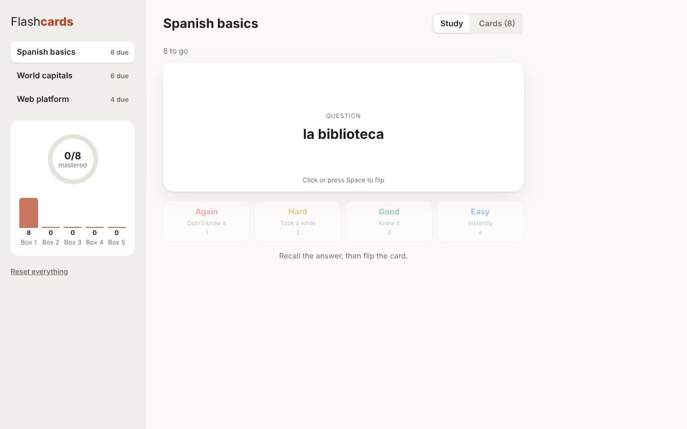
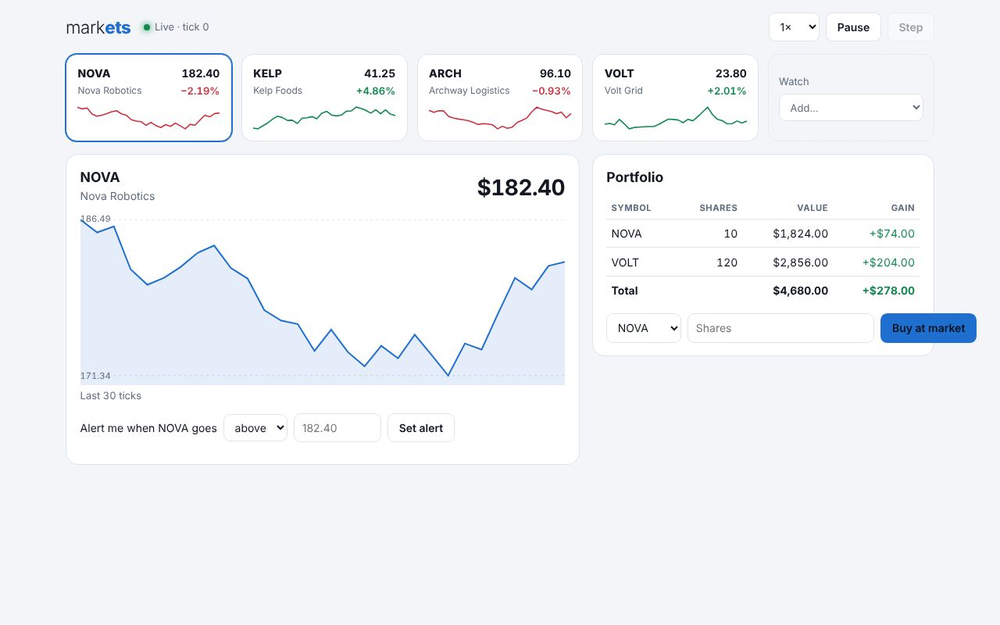
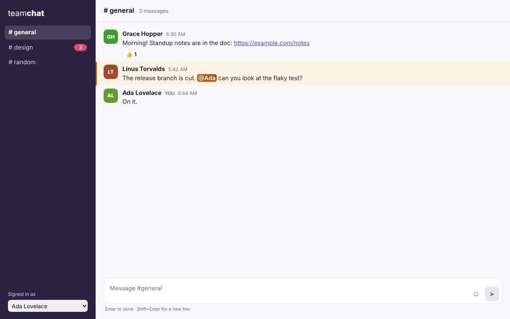
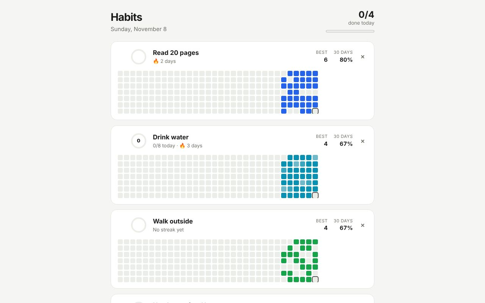
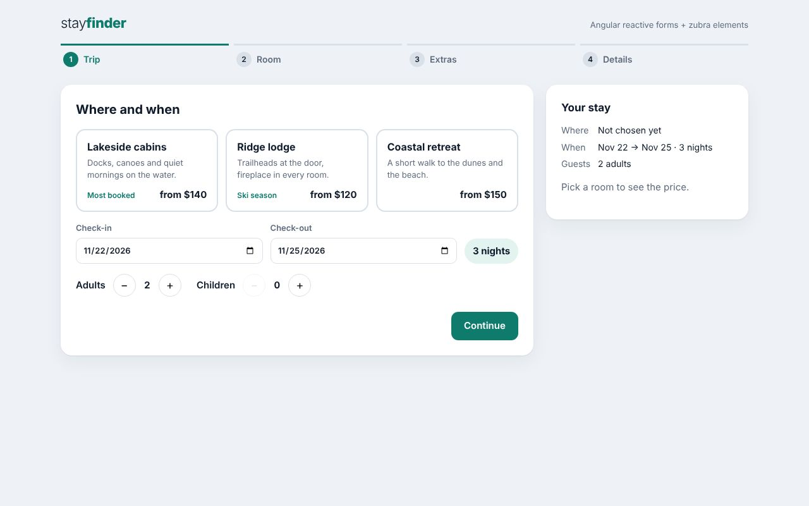

# Zubra in every framework

One app per framework Zubra supports, each a complete idea rather than a demo of one feature. The
UI is a mix of the framework's own components and Zubra elements, used the way that framework uses
any element: no wrappers written by hand, no glue code.

Every app runs live in the [demo gallery](https://journey-to-code-org.github.io/zubra/):

| | |
|---|---|
| [](https://journey-to-code-org.github.io/zubra/demos/react-board/)<br>[Sprint board](https://journey-to-code-org.github.io/zubra/demos/react-board/) (React) | [](https://journey-to-code-org.github.io/zubra/demos/vue-budget/)<br>[Budget tracker](https://journey-to-code-org.github.io/zubra/demos/vue-budget/) (Vue) |
| [](https://journey-to-code-org.github.io/zubra/demos/svelte-flashcards/)<br>[Flashcards](https://journey-to-code-org.github.io/zubra/demos/svelte-flashcards/) (Svelte) | [](https://journey-to-code-org.github.io/zubra/demos/solid-markets/)<br>[Market dashboard](https://journey-to-code-org.github.io/zubra/demos/solid-markets/) (Solid) |
| [](https://journey-to-code-org.github.io/zubra/demos/lit-chat/)<br>[Team chat](https://journey-to-code-org.github.io/zubra/demos/lit-chat/) (Lit) | [](https://journey-to-code-org.github.io/zubra/demos/preact-habits/)<br>[Habit tracker](https://journey-to-code-org.github.io/zubra/demos/preact-habits/) (Preact) |
| [](https://journey-to-code-org.github.io/zubra/demos/angular-booking/)<br>[Booking wizard](https://journey-to-code-org.github.io/zubra/demos/angular-booking/) (Angular) |  |

| App | Framework | What it is | What it shows |
| --- | --- | --- | --- |
| [`react-board/`](react-board/) | React 19 | A sprint board | `.zb` imports as React components; React-managed children in an element's slots (reordered, filtered, added); drag and drop; a column from a component library (`zubra build --lib`); a card editor converted from React with `zubra convert` ([how](react-board/CONVERTED.md)); undo |
| [`vue-budget/`](vue-budget/) | Vue 3 | A budget tracker | `v-model` on Zubra elements, including form controls inside `v-for`, from a component library's Vue entry (`zubra build --lib`); slot content from a Vue template; an SVG donut chart built from Vue's computed state |
| [`svelte-flashcards/`](svelte-flashcards/) | Svelte 5 | A spaced-repetition trainer | A shadow-DOM element with named slots filled from Svelte markup; `{#key}` re-creation; an element listening on the document (1–4 keys) and cleaning up |
| [`solid-markets/`](solid-markets/) | Solid | A live market dashboard | `prop:`/`on:` bindings updated on every tick; nested Zubra elements (a tile's spark line); an SVG chart with pointer events; price alerts and a portfolio |
| [`lit-chat/`](lit-chat/) | Lit 3 | A team chat | Light-DOM Zubra elements inside a LitElement's shadow root, with their styles adopted there; the signed-in user provided by `@lit/context` and read by Zubra's `inject()` (the context protocol) |
| [`preact-habits/`](preact-habits/) | Preact 10 | A habit tracker | Objects as props; a colour from Preact's `style` prop reaching into elements as a custom property; a contribution-style grid with keyboard navigation; a Zubra form control in a Preact form |
| [`angular-booking/`](angular-booking/) | Angular 22 | A booking wizard | Reactive forms whose controls are Zubra elements (`zubraModel` with `formControlName`), validation, a step indicator; compiled ahead of time in Vite with Analog's plugin |

[`ui/`](ui/) is a component library built from the registry with `zubra build --lib`, which the
React and Vue apps import like any package from npm.

Astro is covered by [`../recipes/`](../recipes/), and plain HTML by [`../todo/`](../todo/) and
[`../planner/`](../planner/).

## Running one

The apps share one toolchain install, in this directory:

```sh
cd examples/frameworks
npm install
cd react-board      # or any other app
npx vite            # npx vite build for a production build
```

Each app also has its own `package.json`, so it works on its own if you copy it out of the
repository and run `npm install` there. Inside the repository the packages are linked from
`runtime/`, `plugin/` and `compiler/`, so build the compiler first: either `npm run build` in
`compiler/` (WebAssembly), or `cargo build` at the root and `ZUBRA_COMPILER=../../../target/debug/zubra npx vite`.

## Tested

`npm test` here builds every app and goes through it in Chromium (`test/<framework>.test.js`):
the features above, a reload where the app saves its data, and no console errors. CI runs it on
every change.

## Notes per framework

- **React**: `import Card from './task-card.zb'` gives a React component. Events are
  `on<Event>` in any casing (`onCardDrop` for `carddrop`). The Vite config dedupes React because
  the runtime is linked from this repository, which has its own copy; installed from npm there's
  only one.
- **Vue**: in `.vue` files the import is a Vue component: `v-model` binds `value` +
  `valuechange`, `@valuechange` listens, `<template #name>` fills a named slot.
- **Svelte, Solid, Lit, Preact**: the element itself. Svelte and Preact set properties for
  defined elements; Solid needs `prop:` (and `attr:` for data attributes); Lit uses `.prop` and
  `@event`.
- **Angular**: `CUSTOM_ELEMENTS_SCHEMA`, `[prop]` and `(event)`; `zubraModel` from
  `@zubra/runtime/angular` makes an element a form control. With Analog's Vite plugin, `.zb`
  files are imported directly. (The Angular CLI's builder doesn't take Vite plugins: compile
  components with `zubra compile --emit js` there.)
