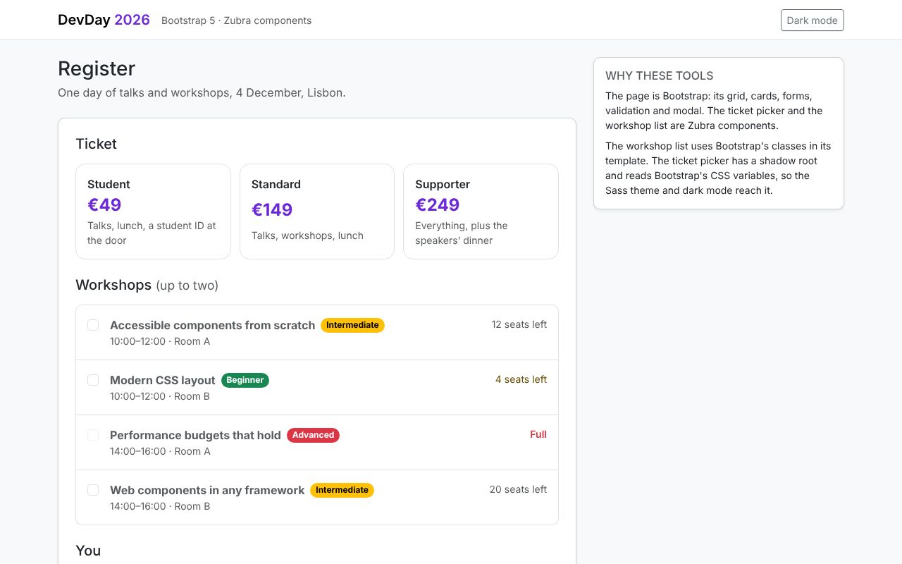

# DevDay registration: Bootstrap 5

**[Open the live demo](https://journey-to-code-org.github.io/zubra/demos/bootstrap-devday/)**, or browse [every example](https://journey-to-code-org.github.io/zubra/).

A conference registration form in plain JavaScript and Bootstrap 5. Bootstrap provides the grid, cards, form fields, validation and modal. The ticket picker and the workshop list are Zubra components.

## What it shows

- **Bootstrap's Sass theme, customised the usual way.** `src/theme.scss` sets `$primary`, `$border-radius` and the font before `@import "bootstrap/scss/bootstrap"`. Bootstrap turns those into CSS variables (`--bs-primary`, `--bs-border-radius-lg`, …).
- **A light-DOM component made of Bootstrap's classes.** `session-list`'s template is Bootstrap markup: `list-group`, `form-check-input`, `badge rounded-pill text-bg-success`. The page's Bootstrap CSS styles it like the rest of the page.
- **A shadow-DOM component on Bootstrap's variables.** `ticket-picker` has a shadow root, which Bootstrap's classes can't reach, so it reads the variables. The violet `$primary` from the Sass file is its price colour and selection ring. `data-bs-theme="dark"` restyles it with the rest of the page.
- **Bootstrap's validation with a Zubra form control.** `ticket-picker` calls `validity()`, so it matches `:invalid` like an input. Bootstrap's own `.was-validated :invalid ~ .invalid-feedback` rule shows its message. One line of SCSS gives it Bootstrap's invalid border colour.
- **Bootstrap's JavaScript next to Zubra.** The confirmation is Bootstrap's Modal (`import { Modal } from 'bootstrap'`), and `FormData` includes the picker's value.

This app is built with Vite. Bootstrap's audience often renders pages on a server instead. That works the same way: `@zubra/server` or the `zubra` CLI renders the components into the server's HTML. See [`../../helpdesk/`](../../helpdesk/) (Express) and [`../../backends/flask-garden/`](../../backends/flask-garden/) (Flask).

`test/bootstrap.test.js` checks the theme, validation, modal and colour modes in Chromium.
