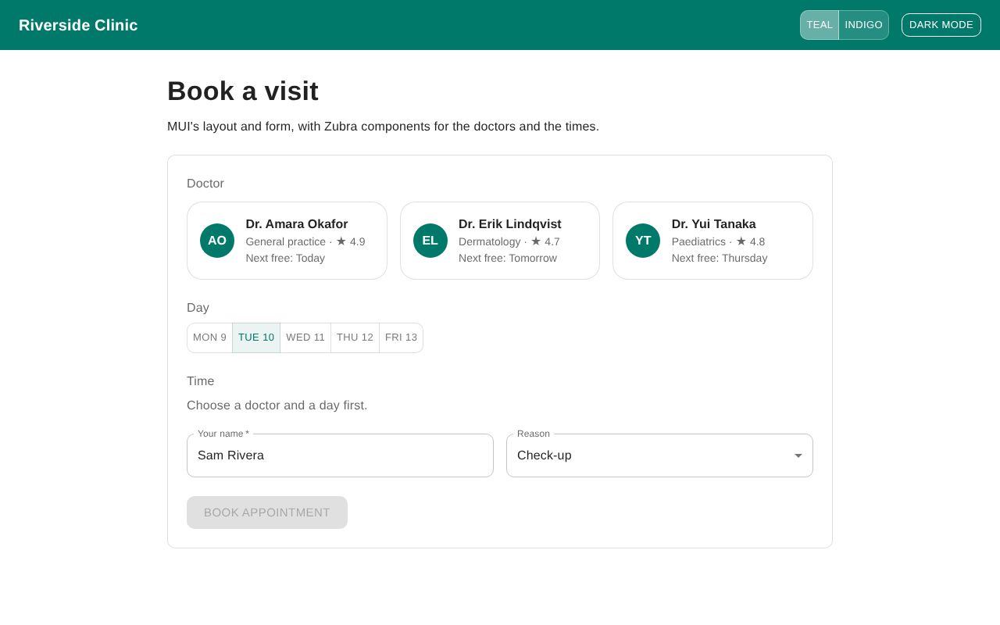

# Riverside Clinic: MUI

**[Open the live demo](https://journey-to-code-org.github.io/zubra/demos/mui-clinic/)**, or browse [every example](https://journey-to-code-org.github.io/zubra/).

Booking a doctor's appointment in React with MUI (Material UI): the app bar, the layout grid, the form and its fields are MUI. The doctor cards and the time picker are Zubra components inside MUI's form.

## What it shows

- **MUI's theme as CSS variables.** MUI styles its own components with CSS-in-JS (Emotion), which can't style other elements. With `createTheme({ cssVariables: … })`, MUI also writes the theme as CSS variables on `<html>` (`--mui-palette-primary-main`, `--mui-shape-borderRadius`, `--mui-font-body1`). Those are what Zubra components read.
- **A light-DOM component and a shadow-DOM one.**
  - `doctor-card` renders in MUI's Grid with its own scoped styles on MUI's variables.
  - `slot-picker` has a shadow root. Custom properties inherit into it, so it gets MUI's colours, radius and font too.
- **Switching the theme at runtime.**
  - The brand colour (Teal or Indigo) builds a new MUI theme, and MUI rewrites the variables.
  - Dark mode uses MUI's `useColorScheme()`, which switches them with a class.
  - Both reach the Zubra components without any code in them.
- **A Zubra control in an MUI form.**
  - `slot-picker` is form-associated: `FormData` includes the chosen time with MUI's TextField and Select values.
  - Submitting without a time shows MUI's `FormHelperText` in MUI's error state.
  - React passes it `value` and listens with `onValueChange`, like a controlled input.

The app is about 160 KB of gzipped JavaScript. React, MUI and Emotion are most of it; the Zubra runtime is about 13 KB, and the two components about 2 KB.

`test/mui.test.js` checks the theme variables, both colour changes and the form in Chromium.
