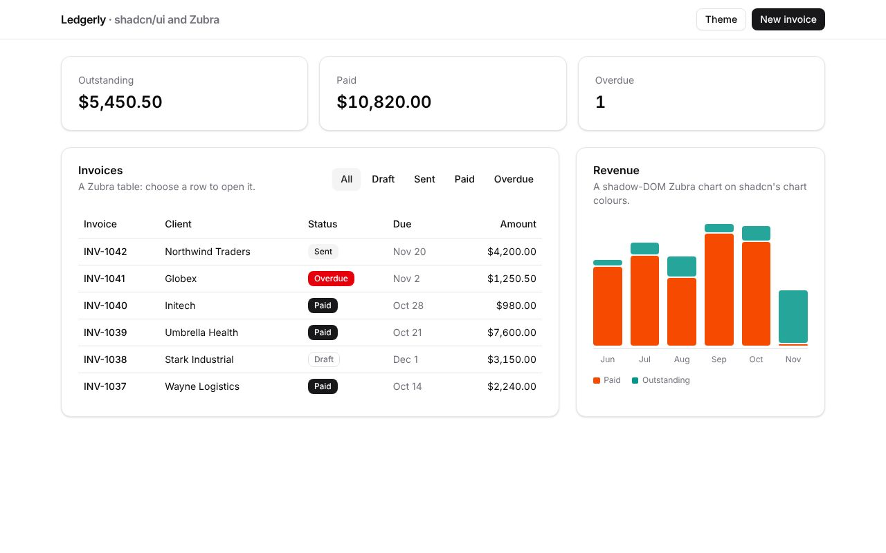

# Ledgerly: shadcn/ui and Radix

**[Open the live demo](https://journey-to-code-org.github.io/zubra/demos/shadcn-invoices/)**, or browse [every example](https://journey-to-code-org.github.io/zubra/).

An invoicing dashboard in React. It uses shadcn/ui for the app's chrome, the dialogs (Radix Dialog) and the theme menu (Radix DropdownMenu). Zubra components sit next to them: the invoice table, the status badges, the revenue chart and the form's status picker. One theme drives both.

## What it shows

- **shadcn/ui as it's normally set up.** `src/components/ui/` is shadcn's source, as `npx shadcn add` writes it (Button, Card, Dialog, DropdownMenu, Input, Label). `src/index.css` is shadcn's Tailwind 4 theme, and `components.json` is its config. Nothing in them knows about Zubra.
- **Zubra components on shadcn's tokens.** The light-DOM components (`invoice-table`, `status-badge`, `status-picker`) use the same Tailwind classes shadcn's components do: `bg-primary`, `text-muted-foreground`, `rounded-md`. A paid badge is the same colour as shadcn's primary Button.
- **A shadow-DOM component on the same theme.** Tailwind classes don't reach `revenue-chart`'s shadow root, but CSS custom properties inherit into it, so the chart uses `var(--chart-1)`, `var(--muted-foreground)` and `var(--radius)` directly.
- **Switching the theme restyles everything.** The theme menu toggles shadcn's `.dark` class and a blue accent theme on `<html>`. Those change the variables, and shadcn's components and the Zubra ones both follow.
- **A Zubra form control inside a Radix Dialog.** The New invoice form is a plain `<form>` in shadcn's Dialog, which Radix portals to the end of `<body>`. `status-picker` is form-associated, so `new FormData(form)` includes its value next to shadcn's Inputs.
- **Zubra events in React.** A row's `invoiceopen` event is `onInvoiceOpen` on the React component, and it opens a shadcn Dialog.

## Files

- `src/App.jsx`: the page: shadcn's components and the Zubra ones (imported from `.zb` files as React components).
- `src/zubra/`: the four Zubra components.
- `src/components/ui/`, `src/lib/utils.js`, `src/index.css`, `components.json`: shadcn/ui.

`test/shadcn.test.js` checks the shared theme, the dialog form and the theme switch in Chromium.
