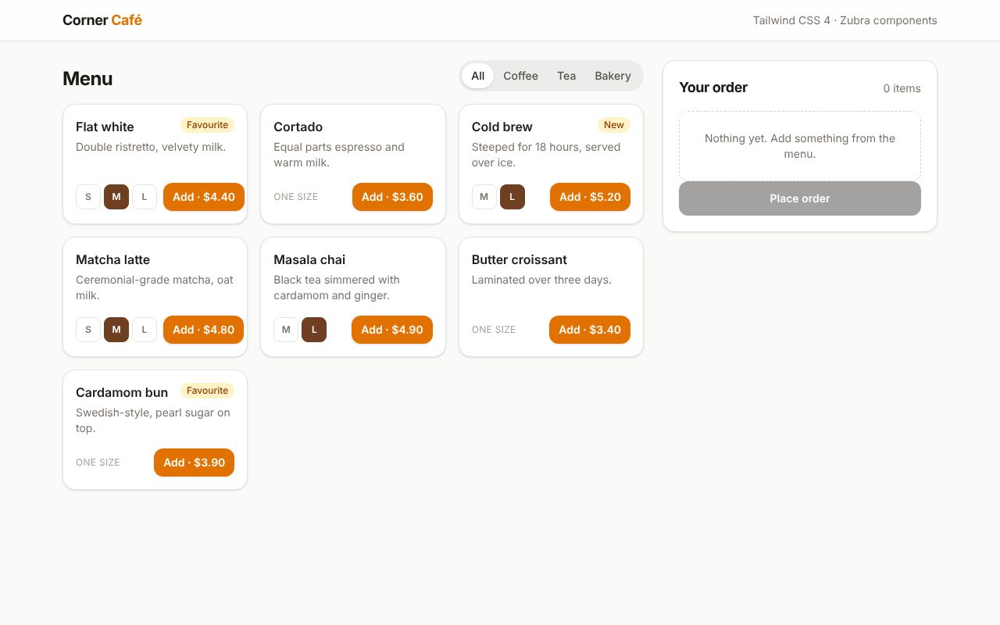

# Corner Café: Tailwind CSS 4

**[Open the live demo](https://journey-to-code-org.github.io/zubra/demos/tailwind-cafe/)**, or browse [every example](https://journey-to-code-org.github.io/zubra/).

A café's order builder: pick a drink's size, add it, and watch the order total up. The page and every Zubra component are styled with Tailwind utility classes, and nothing else.

## What it shows

- **Utilities in `.zb` templates.** Tailwind 4's scanner finds class names in `.zb` files with its other sources, so `class="rounded-2xl bg-white p-4"` in a component's template just works. There's no config to write.
- **Light-DOM components need nothing more.** `menu-card` and `category-tabs` render into the page, so the page's Tailwind CSS styles them. That covers variants (`hover:`, `aria-pressed:`, `data-active:`, `dark:`), arbitrary values (`active:scale-[0.97]`) and the page's own `@theme` colour (`bg-roast`).
- **A shadow-DOM component gets the same CSS through `adoptStyles()`.** Page CSS doesn't reach into a shadow root, so `src/main.js` imports the compiled CSS as a string (`import tailwind from './app.css?inline'`) and passes it to `adoptStyles()`. `order-summary` then uses utilities like any other markup. Tailwind 4 writes its theme variables for `:root, :host`, so they're defined inside the shadow root too.
- **Dark mode reaches both** with Tailwind's default `dark:` variant (`prefers-color-scheme`).

## A catch with class-based dark mode

If you switch dark mode with a class on `<html>` (`@custom-variant dark (&:where(.dark, .dark *))`), the light-DOM components follow, but shadow roots don't: a selector inside a shadow root can't see the page's `<html>` class. Either keep the media-query variant, as here, or put shadow components on CSS variables that the class switches. The shadcn/ui example ([`../shadcn-invoices/`](../shadcn-invoices/)) takes that second route.

## Files

- `src/app.css`: `@import "tailwindcss"` and a `@theme` colour.
- `src/main.js`: the menu and the order as plain JavaScript state, and `adoptStyles()`.
- `src/components/`: `menu-card`, `category-tabs` (light DOM) and `order-summary` (shadow DOM).

Run it as the other apps here run (see [`../README.md`](../README.md)). `test/tailwind.test.js` checks the computed styles in Chromium.
