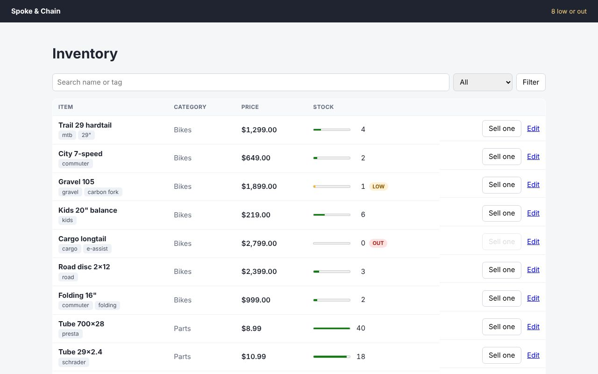

# Spoke & Chain: Hono and htmx



This one needs a server, so it isn't in the [live demos](https://journey-to-code-org.github.io/zubra/); the commands below run it.

A bike shop's inventory with search, paging, quick sales and inline editing. It's built with
[Hono](https://hono.dev) and [htmx](https://htmx.org), and runs on **Node.js or Bun**:

```sh
cargo build                 # from the repository root (see below)
cd examples/hypermedia/hono-bikes
npm install
npm start                   # Node.js: http://localhost:3000
npm run start:bun           # or Bun
```

Every route answers in two ways:
- a plain request gets a whole page, so the shop works without JavaScript;
- an htmx request (`HX-Request: true`) gets just the fragment to swap: a row, the edit form, the
  next page, or the search results, plus the low-stock count out of band.

The Zubra components in those fragments are rendered on the server. The browser hydrates them
wherever htmx puts them.

| | |
|---|---|
| `src/shop.js` | Routes and templates, with `hono/html`, as `createShop({ store, middleware, htmx, css })`. It reads no files and imports nothing from Node.js, so a Worker can run it too (see `examples/edge/hono-bikes-worker`). |
| `src/app.js` | The Node.js host: reads htmx and the stylesheet, builds `@zubra/server/hono`'s middleware over `components/` (which renders components with `@zubra/compiler` and serves their browser modules and `@zubra/runtime`), and returns `createShop(...)`. |
| `src/store.js` | The inventory, in memory. |
| `components/` | `price-tag` and `stock-gauge` (rendered completely on the server), `tag-list`, and `qty-input` (a native number input that gains − and + buttons). |
| `test/app.test.js` | Chromium against the server on Node.js and on Bun, with and without JavaScript. |

`@zubra/compiler` installed from npm carries its WebAssembly build. Inside this repository, the
CLI from `cargo build` stands in for it, as in `examples/helpdesk/`.

## What it found

- **Hydration markers survive htmx's fragment parser.**
  - htmx 2 parses fragments with `Document.parseHTMLUnsafe()` where the browser has it.
  - In the Chromium build Playwright ships (153), that drops every comment. MDN says it
    shouldn't with no sanitizer, so this looks like a browser bug, but it's what this browser
    does.
  - Zubra's markers are processing instructions (`<?zb [?>`), which `parseHTMLUnsafe` keeps, and
    a test checks that swapped elements keep their markers. If something strips them anyway, an
    element puts them back by structure where it can.
- **Custom elements can't be table rows.** `<inventory-row>` in a `<tbody>` is moved out of the
  table by the HTML parser. So the rows are plain `<tr>`s in Hono's templates, with components
  in their cells, and each row costs three renders.
- **One render per component, per row.** A page of 10 rows is 30 renders. With the CLI standing
  in (one process each), that's about 100 ms. With the WebAssembly build in the same process,
  it would be far less. A batch render (many components in one request) would help either way.
- **Formatting money takes string work.** The server's renderer runs `toFixed` and `slice`, but
  not `Intl.NumberFormat`, whose output depends on the platform. So `price-tag` groups the
  thousands itself to build `$1,299.00`.
- **htmx and Zubra agree on form fields.** `qty-input` keeps its native `<input name>` in light
  DOM, so htmx's `hx-post` sends it like any other field. Its `valuechange` and htmx's own
  events don't collide.
