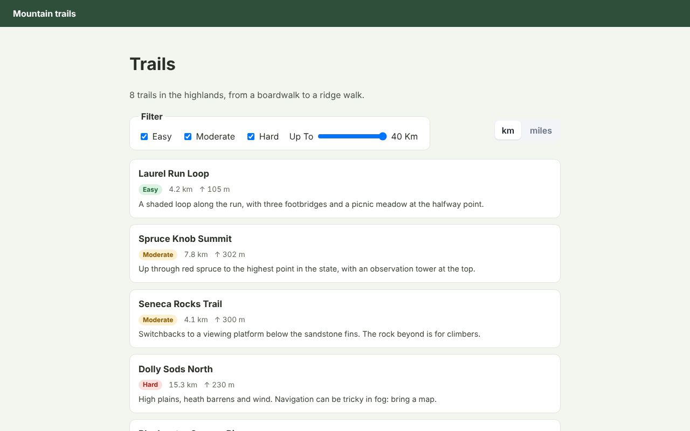

# Mountain trails: Eleventy

[](https://journey-to-code-org.github.io/zubra/demos/eleventy-trails/)

**[Open the live demo](https://journey-to-code-org.github.io/zubra/demos/eleventy-trails/)**, or browse [every example](https://journey-to-code-org.github.io/zubra/).

A static trail guide built with [Eleventy](https://www.11ty.dev). Its Zubra components are
rendered to HTML **at build time** by a shortcode:

```njk

```

They're hydrated in the browser with no bundler. The browser gets:
- the HTML;
- each component compiled to an ES module;
- `@zubra/runtime`, through an import map.

```sh
cargo build                 # from the repository root (the CLI stands in for @zubra/compiler's WebAssembly build)
cd examples/meta/eleventy-trails
npm install
npm start                   # http://localhost:8080
```

`eleventy.config.js` has the whole integration, in about 50 lines:
- **the shortcode**, which also records which components each page used;
- **a transform**, which puts those components' CSS in the page's `<head>` and imports their
  modules at the end of its body;
- **an `eleventy.after` step**, which writes `_site/components/*.js` and copies the runtime to
  `_site/vendor/zubra/`.

Without JavaScript, the list, every trail's facts and its elevation profile are all in the HTML.
With JavaScript, a filter appears (difficulty and length), and the units switch between km and
miles on every card. The choice is remembered.

## What it found

- **HTML minifiers keep the hydration markers.** They're processing instructions (`<?zb [?>`),
  which minifiers keep: `MINIFY=1 npm run build` uses plain `removeComments: true`, and the
  elements hydrate in place. If something strips them anyway, an element puts them back by
  structure where it can.
- **Build-time rendering runs the components' JavaScript.** The elevation profile works out its
  own SVG points with `.map()` and `Math.round()`: the renderer runs a component's deterministic
  JavaScript (never `Intl`, `Date` or `Math.random`). `_data/trails.js` gives each trail both
  units and its climb.
- **The filter needs JavaScript, so it only renders once live** (the `live` pattern, a fourth
  time).
