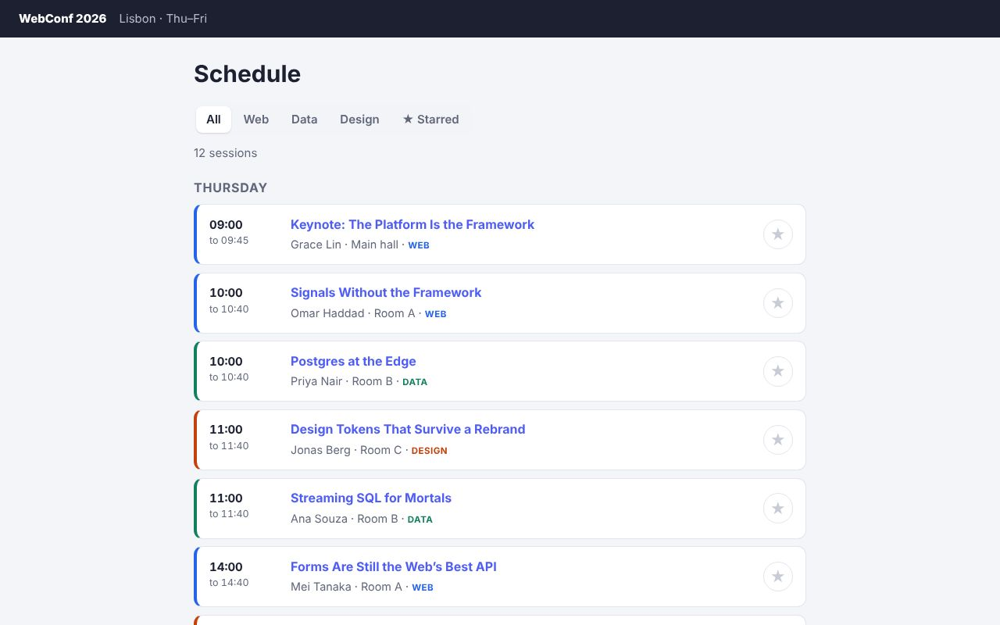

# WebConf: Next.js with Zubra components



This one needs a server, so it isn't in the [live demos](https://journey-to-code-org.github.io/zubra/); the commands below run it.

A conference schedule. Filter the talks by track, star the ones you want (kept in `localStorage`), and rate a talk afterwards through a form handled by a **Server Action**.

Next.js 16 builds with Turbopack, which takes webpack-style loaders but not bundler plugins. `next.config.mjs` gives `.zb` files Zubra's loader (`@zubra/unplugin/loader`, since 2.8), and the app imports components directly, as React (client) components:

```jsx
'use client';
import SessionCard from '../components/session-card.zb';
```

(Before 2.8 the app used library mode, `zubra build --lib`, which still works for a component package.)

| What | Where |
|---|---|
| A Server Component reading data, passing it to a client component that uses Zubra elements | `app/page.jsx` → `app/Schedule.jsx` |
| Two-way props as React state (`value` + `onValueChange`, `starred` + `onStarredChange`) | `app/Schedule.jsx` |
| Zubra **form controls** in a Server Action form: `star-rating` and `toggle-switch` are form-associated, so `rating` and `followup` arrive in `FormData`, and `required` stops the submission like a native input | `app/sessions/[id]/FeedbackForm.jsx`, `app/actions.js` |
| Components from the registry (`zubra add segmented-control star-rating toggle-switch`) beside the app's own (`session-card`) | `components/` |

```sh
npm install
npm run dev        # edits to components/ rebuild through the loader
npm run build && npm start
npm test           # builds, starts, and drives it in Chromium
```

Inside this repository, the Zubra compiler comes from `ZUBRA_COMPILER` (the CLI from `cargo build`) or a built `compiler/zubra.wasm`. `.npmrc` installs the repository's packages as copies (`install-links`), as they'd come from npm. Next won't resolve a symlinked package outside the app.

## What this app found

These are recorded in the project's server roadmap (`plan/roadmap-server.md`).

- **The components are shadow DOM here.** Next server-renders each element's host tag, and the browser defines the elements before React hydrates. A light-DOM element then renders its template into the host, React finds children it didn't render, reports a hydration error (#418), and re-renders the page from scratch. Shadow-DOM elements render into their shadow root, which React doesn't look at, so they hydrate cleanly. Making light DOM work under framework hydration is on the roadmap.
- **The element's own markup wasn't in the server HTML** (fixed in 2.11). React rendered the host tag (`<session-card>`, with its props as `zb-props` since 2.8) on the server, and the card's template appeared once the element started. In React Router, Nuxt, SvelteKit and SolidStart, `@zubra/server` adds the shadow roots to the page (2.8). Next streams React Server Components and has no hook for its HTML. So in 2.11:
  - the loader's server build (`next.config.mjs`, `options: { server: true }`) registers how to render each component;
  - the React wrapper writes a childless shadow-DOM element's declarative shadow root as the host's inner HTML.

  React doesn't hydrate inner HTML, so nothing disagrees. The test checks the cards without JavaScript, and that the elements keep the parser's nodes when they start.
- **What a spike found first** (`plan/roadmap-3.0.md`, 2.11): a `<template shadowrootmode>` as a React *child* breaks hydration. The parser turns it into a shadow root, React finds a different child, reports #418 and re-renders the page, and a template React creates is never a shadow root. As the host's inner HTML (an empty string in the browser, with `suppressHydrationWarning`), it's clean in `next dev` and in production.
- **Fixed while building it:** library mode's React entry now starts with `'use client'`, so it can be imported from a Server Component. The runtime no longer reports an empty URL (a prop's `""` default, before the app sets it) as unsafe.
