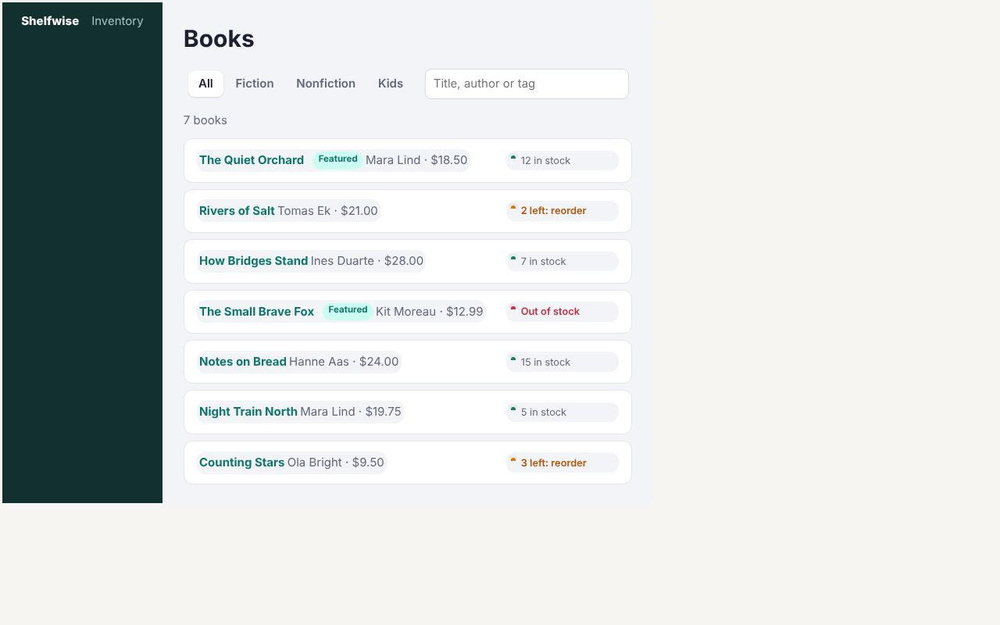

# Shelfwise: Nuxt with Zubra components



This one needs a server, so it isn't in the [live demos](https://journey-to-code-org.github.io/zubra/); the commands below run it.

A bookshop's inventory. Filter books by genre (filtered on the server, with the URL kept in sync), see stock against each book's reorder point, and edit a book's price, stock, tags and front-page flag, saved through a Nitro API route that validates them.

Nuxt builds with Vite, so the Zubra plugin goes straight into `nuxt.config.ts`:

```ts
import zubra from '@zubra/unplugin/vite';
export default defineNuxtConfig({ vite: { plugins: [zubra()] } });
```

Imported into a `.vue` file, a `.zb` file is a Vue component:

```vue
<MoneyInput v-model="draft.price" label="Price" :min="0.01" />
<ToggleSwitch v-model:checked="draft.featured" label="Featured" />
```

| What | Where |
|---|---|
| `v-model` on Zubra elements (`value`), and `v-model:checked` on a `:model` prop with another name | `app/pages/books/[id].vue` |
| A filter on a Zubra element driving `useFetch`'s query, so Nitro filters on the server, and the URL follows | `app/pages/index.vue` |
| Registry components (`zubra add money-input quantity-stepper tag-input toggle-switch segmented-control`) beside the app's own `stock-meter` | `zubra/` |
| An API that validates what the editor sends (422 with field errors) | `server/api/books/[id].put.ts` |

```sh
npm install
npm run dev
npm run build && npm start      # PORT=3000 by default
npm test                        # builds, starts, drives it in Chromium
```

Inside this repository, the Zubra compiler is the CLI from `cargo build` (the tests find it) or a built `compiler/zubra.wasm`. `.npmrc` installs the repository's packages as copies, as they'd come from npm.

## What this app found

These are recorded in the project's server roadmap (`plan/roadmap-server.md`).

- **Light DOM works here only for an element given no Vue children, and the failure is worse than in the Next.js app.** Nuxt server-renders each element's host tag, and the browser defines the elements before Vue hydrates. If a light-DOM element rendered its template into the host first, Vue would fix the mismatch by *removing* the nodes it didn't expect: the element's template, leaving it empty. The Vue wrapper prevents that for an element with no children: on the server it writes the element's content as the host's inner HTML, and in the browser the vnode has no children, so Vue never looks inside the host. `stock-meter` is light DOM this way; an element given slot content has to be `shadow`.
- **Vue server-renders a bare host tag.** The Vue wrapper writes the props as `zb-props`, and `server/plugins/zubra.ts` adds each shadow-DOM element's shadow root to the page, so the meters and controls are right before JavaScript.
- `zubra add` from a locally installed `@zubra/compiler` has no registry: the registry is copied into the package when it's published. The repository's own `compiler/cli.js add` was used here.
