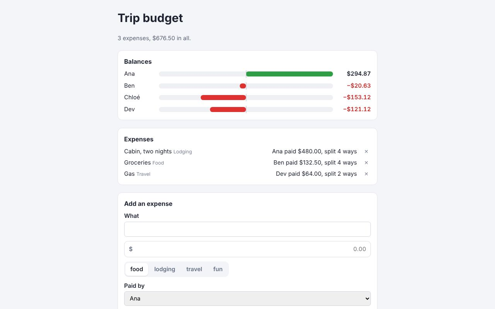

# Trip budget: React Router 8



This one needs a server, so it isn't in the [live demos](https://journey-to-code-org.github.io/zubra/); the commands below run it.

A shared trip budget in React Router 8's framework mode: who paid for what, who's up and down,
and a form to add an expense. It uses:
- a server `loader` and `action`;
- `<Form>` for adding, and `useFetcher` for deleting;
- validation errors returned from the action.

React Router builds with Vite, so its routes import `.zb` files directly:

```jsx
import MoneyInput from '../../zubra/money-input.zb';
<MoneyInput name="amount" label="Amount" required value={amount} onValueChange={(event) => setAmount(event.detail)} />
```

The components are `balance-list` (its own) and the registry's `money-input` and
`segmented-control`. The registry's two are form-associated, so they submit with `<Form>` like
native inputs.

```sh
cargo build                 # from the repository root (the CLI stands in for @zubra/compiler's WebAssembly build)
cd examples/meta/react-router-trips
npm install
npm run dev                 # or: npm run build && npm start
```

## What it found

- **What the Next.js app found applies here too** (`../README.md`):
  - `balance-list` is light DOM and given no React children, so the React wrapper server-renders
    its content and React leaves it alone while hydrating. An element given React children would
    have to be `shadow`; the plugin warns about a light-DOM component server-rendered here;
  - React renders only the host tags, so `app/entry.server.jsx` pipes React's stream through
    `zubra.injectShadowRootsStream()`, which adds the shadow-DOM controls' shadow roots;
  - without JavaScript, each named control has a hidden input until it starts, so the action gets
    the payer and category; the amount is a text field, whose edits need JavaScript, so the test
    sees "An amount above $0.".
- **Form-associated controls work with React Router's `<Form>`.** `FormData` picks up their
  values, a form `reset()` clears them, and the action reads them like any other field.
