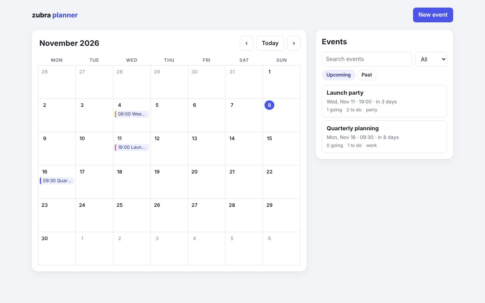

# Event planner

[](https://journey-to-code-org.github.io/zubra/demos/planner/)

**[Open the live demo](https://journey-to-code-org.github.io/zubra/demos/planner/)**, or browse [every example](https://journey-to-code-org.github.io/zubra/).

The largest example: a single-page app for planning events, written only in `.zb` components
and plain JavaScript modules. No framework, no router library, no state library.

```sh
cd examples/planner
npm install
npm run dev
```

The example links the packages in this repository, so the compiler needs building once: either
`npm run build` in `compiler/` (WebAssembly; needs the `wasm32-unknown-unknown` Rust target), or
`cargo build` at the root and `ZUBRA_COMPILER=../../target/debug/zubra npm run dev`.

## What you can do

- See events on a **month calendar** and in a **searchable list** (by text and category,
  upcoming or past). Pick an empty day to create an event on it.
- **Create and edit** events in a modal dialog that checks the times.
- On an event's page, plan it in four tabs:
  - **Schedule**, sorted by time, flagging items at the same time or outside the event's hours.
  - **Guests**, with RSVPs, plus-ones, a filter by RSVP and a headcount. Duplicate emails are
    refused.
  - **Budget**, with expenses by category, what's paid, and what's left (or over).
  - **Tasks**, with progress, hiding done tasks and clearing them.
- **Export** an event as an `.ics` file for any calendar app.
- **Delete** an event, with a confirmation.

Everything is saved to `localStorage`. A first visit starts with three sample events around
today.

## How it's built

| File | What it shows |
| --- | --- |
| `store.js` | The data as one `Signal.State`, with plain functions that replace it immutably and save it. `usePlanner()` is a custom hook. |
| `planner-app.zb` | `provide()` puts the store in context. The route (`#/` or `#/events/<id>`) is a `let` that a `hashchange` listener (`onMount`, with cleanup) assigns. |
| `month-calendar.zb` | Nested keyed lists (weeks, days, events). Events come from context through an explicit `computed()`. Fires `daypick`. |
| `upcoming-list.zb` | Search, filter and sort as a `computed()` over context and three `let`s. |
| `event-dialog.zb` | A native `<dialog>` opened and closed by `watch()` on the `event` prop. Form fields bound to the event, native validation with a custom check, `id()` for labels. Fires `save` and `close`. |
| `event-page.zb` | Tabs as `let` state and `zb-if`, a summary computed from the event, a two-step delete, and the `.ics` download. |
| `schedule-list.zb`, `guest-list.zb`, `budget-table.zb`, `task-list.zb` | Each takes the event as a prop and derives everything else from it with plain `const`s. They change data through the store, so every view of it updates. |

Each component has scoped styles. `src/page.css` holds the design tokens (with a dark theme)
and element defaults, in the `base` cascade layer, so components' styles win over it.

The data flows one way. Components read the store (from context) or an event (as a prop), and
change it only through the store's functions. Nothing re-renders: each binding updates when the
value it reads changes.

`plugin/test/examples.test.js` builds the app and goes through all of the above in Chromium,
including reloading the page and checking the exported file.
